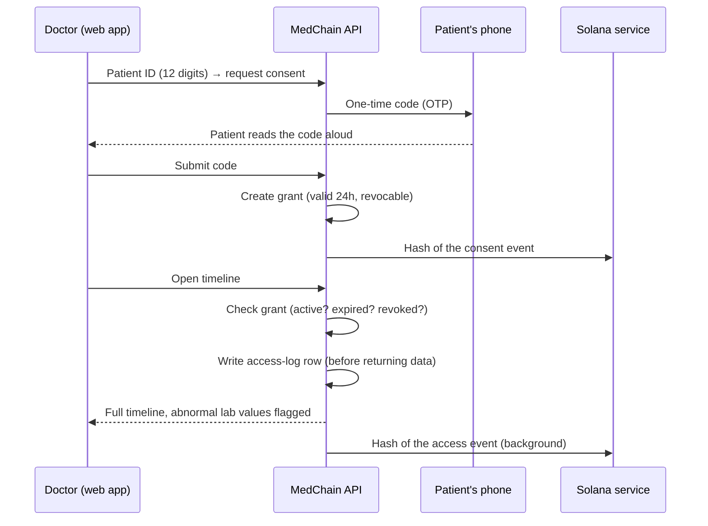
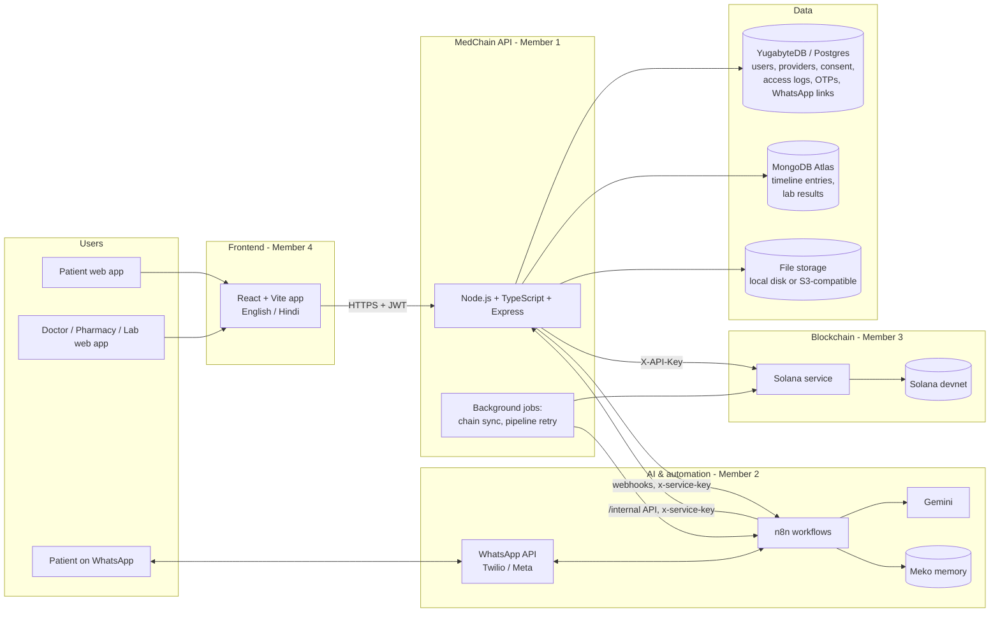
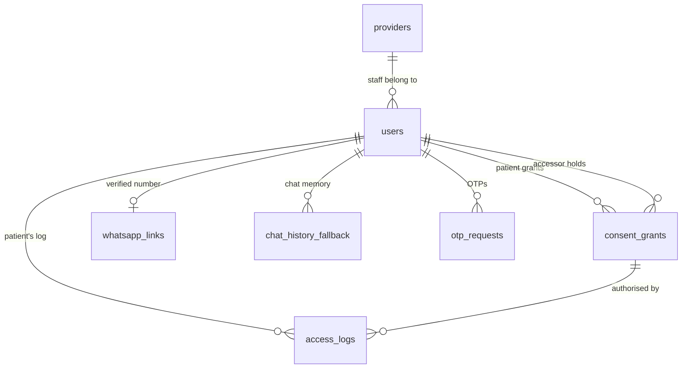
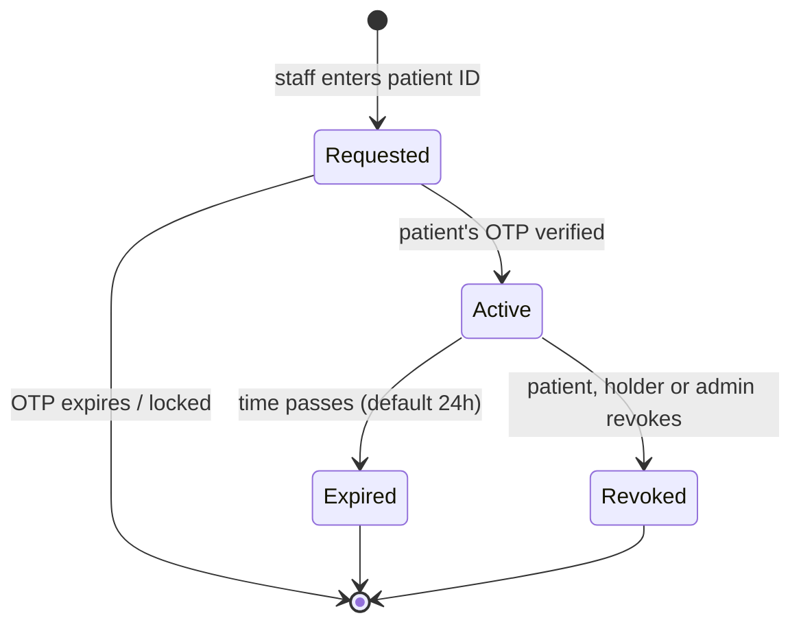
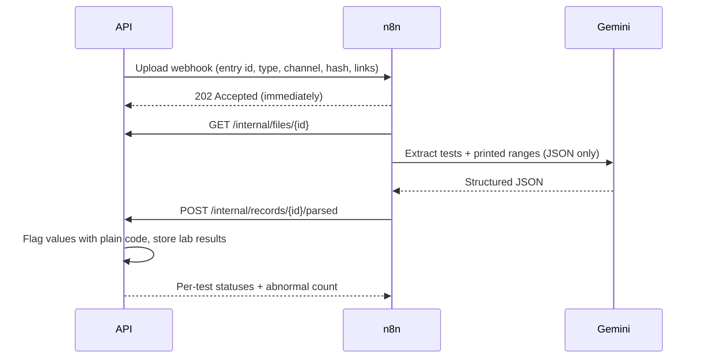

# MedChain

**A consent-based, lifelong medical timeline for every patient, so that no doctor ever has to treat a patient blind.**

Built for **HackCBS** by a team of four, competing in the main track and the **MLH sponsor tracks**.

> ⚠️ **Prototype notice.** MedChain is a hackathon prototype. It uses **only fake demo data**, OTPs are simulated, and it
> is **not a medical device**. It never diagnoses and never gives dosage advice. Nothing in this repository should be
> used with real patient data without a full security, legal and clinical review.

---

## Table of contents

1. [The problem](#1-the-problem)
2. [Our solution in one minute](#2-our-solution-in-one-minute)
3. [Who it is for](#3-who-it-is-for)
4. [How it works: the main journeys](#4-how-it-works-the-main-journeys)
5. [Design principles](#5-design-principles)
6. [Architecture](#6-architecture)
7. [Technology stack and why we chose it](#7-technology-stack-and-why-we-chose-it)
8. [Repository structure](#8-repository-structure)
9. [Data model](#9-data-model)
10. [Consent: the heart of the system](#10-consent-the-heart-of-the-system)
11. [Medical records and the timeline](#11-medical-records-and-the-timeline)
12. [AI: reading reports without diagnosing](#12-ai-reading-reports-without-diagnosing)
13. [Blockchain: proof, not storage](#13-blockchain-proof-not-storage)
14. [The WhatsApp assistant](#14-the-whatsapp-assistant)
15. [Access log: who looked at my records?](#15-access-log-who-looked-at-my-records)
16. [Provider onboarding and verification](#16-provider-onboarding-and-verification)
17. [Security and privacy](#17-security-and-privacy)
18. [API overview](#18-api-overview)
19. [Running it locally](#19-running-it-locally)
20. [Configuration reference](#20-configuration-reference)
21. [Deployment](#21-deployment)
22. [Demo accounts and demo script](#22-demo-accounts-and-demo-script)
23. [Testing](#23-testing)
24. [Troubleshooting](#24-troubleshooting)
25. [Honest status: what is real and what is simulated](#25-honest-status-what-is-real-and-what-is-simulated)
26. [Roadmap](#26-roadmap)
27. [Team](#27-team)
28. [FAQ](#28-faq)
29. [Hackathon: HackCBS and MLH tracks](#29-hackathon-hackcbs-and-mlh-tracks)

---

## 1. The problem

### 1.1 Medical history is scattered, and patients carry the burden

In India, a person's medical history is usually spread across many places: a prescription from a neighbourhood clinic,
a discharge summary from a hospital in another city, lab reports from two or three diagnostic centres, and pharmacy bills
that list what was actually dispensed. Very little of this is connected. In most cases the **patient is the only link**
between these records, and the "system" is a plastic folder, a drawer at home, or photos on a phone.

That works only as long as the patient:

- keeps every paper and never loses one;
- remembers which tests were done, when, and what the values were;
- remembers every medicine they take, the exact names and the doses;
- brings all of it to every appointment;
- is well enough, at the moment of care, to explain their own history.

Each of those assumptions breaks regularly, and they break most often for the people who need care the most.

### 1.2 Senior citizens are hit hardest

Older patients typically see more doctors, take more medicines and have more tests, so they have the **largest** history
to keep track of. They are also the people most likely to:

- forget a test result, a diagnosis date or a medicine name;
- misplace papers, or have them handled by different family members;
- struggle with complicated apps, passwords and portals;
- arrive at a new clinic, or an emergency, without anyone who knows their history.

### 1.3 What it costs when a doctor treats "blind"

When a doctor cannot see the history, care suffers in very concrete ways:

- **Repeated tests:** the same test is ordered again because the earlier report is not available. That costs money
  and time, and sometimes involves avoidable procedures.
- **Missed trends:** a single reading looks "slightly high", but nobody can see that it has been rising for a year.
- **Drug interactions and duplicates:** a new prescription may clash with something the patient already takes, or
  duplicate it under a different brand name.
- **Longer, harder consultations:** time goes to reconstructing history instead of treating the patient.
- **Risk in emergencies:** the patient may be unable to speak for themselves at the worst possible moment.

### 1.4 Why existing approaches fall short

| Approach | What goes wrong |
|---|---|
| Paper files kept by the patient | Get lost or damaged; hard to read; never complete; no trends |
| Each hospital's own system | Each one sees only its own data; nothing travels with the patient |
| Photos in a phone gallery | Unorganised, unsearchable, mixed with personal photos; not shareable in a controlled way |
| Sharing over chat apps | No consent trail, no expiry, no record of who saw what; copies spread uncontrollably |
| Complex health portals | Hard for elderly users; passwords get forgotten; low adoption |

There is also a **trust problem** on both sides:

- Patients worry about who can see their medical data, for how long, and whether it is used for anything other than
  their care.
- Doctors worry whether a document is genuine and unaltered, especially when the patient uploaded it themselves.

### 1.5 The problem statement

> Patients, especially senior citizens, lose or forget prescriptions, bills and reports, so doctors lack their medical
> history. We need a way to build a **lifelong, complete, trustworthy medical timeline** for each patient that a doctor
> can see **only with the patient's explicit, time-limited consent**, that records **every access transparently**,
> and that works for people who are not comfortable with technology.

---

## 2. Our solution in one minute

MedChain gives every patient **one lifelong medical timeline**: visits, prescriptions, pharmacy bills and lab reports,
in date order. Four ideas make it work:

1. **Consent by OTP, not by paperwork.** A doctor enters the patient's ID, the patient receives a one-time code on their
   phone, and reading it out *is* the consent. Access lasts a limited time (24 hours by default), and the patient can
   revoke it at any moment.
2. **Records flow in from where care happens.** Pharmacies and diagnostic centres upload bills and reports directly to
   the patient's timeline (with consent). Patients can add anything else themselves, clearly labelled as
   *"Patient-uploaded, unverified"*.
3. **AI reads reports, plain code flags values, and nothing diagnoses.** An AI model (Gemini) extracts the test names,
   values and the reference ranges printed on each lab report. Simple, auditable code then marks values outside those
   printed ranges, so the doctor sees the abnormal ones at a glance.
4. **Tamper-evidence without exposing data.** Only **hashes** (fingerprints) of documents, consents and access events are
   written to the Solana blockchain. Anyone can later verify that a document has not been altered, and **no medical
   data ever goes on-chain**.

On top of that:

- **Every view is logged.** The patient can see who opened their records, when, and under which consent.
- **A WhatsApp assistant** lets patients send photos of prescriptions and bills, and ask questions answered **only from
  their own records**. No new app is needed.

---

## 3. Who it is for

| User | What they get |
|---|---|
| **Patient** (especially seniors) | One complete history; control over who sees it; a log of every access; uploads via app or WhatsApp; answers about their own records |
| **Family member / caregiver** | A simpler way to manage an elderly relative's papers (via the patient's own account and phone) |
| **Doctor** | The full timeline in seconds, abnormal values highlighted, verified documents, no "blind" treatment |
| **Pharmacy** | Upload dispensing bills to the patient's timeline; see prescriptions with consent |
| **Diagnostic centre / lab** | Upload reports straight to the patient's timeline, where the AI reads them automatically |
| **MedChain admin** | Verify which clinics, pharmacies and labs may join; suspend them if needed |

---

## 4. How it works: the main journeys

### 4.1 A doctor visit



1. The doctor logs in with email and password.
2. They type the patient's 12-digit ID. The ID is hashed immediately and never stored in plain form.
3. MedChain sends an OTP to the **patient's registered mobile**. The patient reads it out; that is their consent.
4. A **grant** is created: valid for 24 hours by default (1–72 hours configurable), for a stated purpose, revocable.
   Its fingerprint is written to Solana.
5. The doctor sees the full timeline. Lab values outside the printed reference range are highlighted.
6. Every view is written to the patient's access log **before** any data is returned. If logging fails, the data is
   not shown.

### 4.2 A pharmacy or lab adds records

The same OTP consent flow, then an upload. A lab uploads a report image or PDF; MedChain compresses it, fingerprints it,
anchors the fingerprint on Solana and hands it to the AI pipeline. A few seconds later, the extracted values appear on
the patient's timeline with any out-of-range values flagged.

### 4.3 A patient uses the app

- **Sign in** with their 12-digit ID and an OTP (no password to forget). First-time users add their mobile and name.
- **See their timeline:** everything in date order, with verification badges.
- **Upload** a photo of an old prescription or a bill from a provider who doesn't use MedChain. It is labelled
  *"Patient-uploaded, unverified"*.
- **See who has access** and revoke any active grant with one tap.
- **See who viewed their records:** name, clinic, time, purpose, and what was opened.
- **Link WhatsApp**, verified by OTP, to use the assistant.
- **Erase chatbot memory** at any time.

### 4.4 A patient uses WhatsApp

- Sends a photo or PDF: it is added to their timeline as patient-uploaded, and the AI reads it.
- Asks a question ("What was my last sugar reading?"): the answer comes **only from their own records**.
- The bot never diagnoses or gives dosage advice. Emergency phrases trigger: *"Please contact a doctor or emergency
  services immediately."*
- The bot identifies the patient **only** by their OTP-verified WhatsApp number. The Aadhaar-based ID is never typed
  into chat.

---

## 5. Design principles

1. **Consent first, always.** Every read of patient data by anyone other than the patient passes through one function
   that checks for an active, unexpired, unrevoked grant. There is no back door.
2. **Transparency to the patient.** Every access is logged and visible to the patient.
3. **Data minimisation.** The raw Aadhaar-based ID is never stored; tokens carry no personal data; machine-to-machine
   responses return only what is needed (for example, a WhatsApp lookup returns only a patient ID).
4. **AI assists, never decides.** AI extracts text. Deterministic code compares numbers. Nobody and nothing "diagnoses".
5. **Blockchain for proof only.** Hashes go on-chain; medical data never does.
6. **Never block care on infrastructure.** If the blockchain or the AI pipeline is down, the user still gets their
   records; background jobs finish the work later.
7. **Designed for senior citizens.** OTP instead of passwords, WhatsApp instead of a new app, Hindi and English, large
   readable UI, clear labels.
8. **Right to erasure.** Off-chain data can be deleted; on-chain hashes reveal nothing about the patient.

---

## 6. Architecture



### 6.1 Responsibilities

| Component | Owner | Responsibility |
|---|---|---|
| **Frontend** (`apps/web`) | Member 4 | Patient and provider web app, bilingual UI, mock mode for offline demos |
| **API** (`apps/api`) | Member 1 | Auth, OTP, consent, records, access log, provider onboarding, integrations, all data rules |
| **AI & automation** | Member 2 | n8n workflows, Gemini extraction, WhatsApp bot, Meko chatbot memory, OTP delivery over WhatsApp |
| **Blockchain service** | Member 3 | Hashing and anchoring records on Solana devnet, verification endpoints |

### 6.2 How the parts talk to each other

| From → To | How | Auth |
|---|---|---|
| Web app → API | REST/JSON over HTTPS | `Authorization: Bearer <JWT>` |
| API → Solana service | REST/JSON | `X-API-Key` |
| API → n8n | Webhooks (upload pipeline, OTP delivery, memory erase) | `x-service-key` (shared secret) |
| n8n → API | `/api/v1/internal/*` (download file, post AI result, WhatsApp lookup, timeline, upload, chat memory) | `x-service-key` |

The contracts between parts are written down in `contracts/`:

- `openapi.yaml`: the machine-readable API (37 operations);
- `frontend-api.md`: the frontend handover;
- `integrations.md`: how n8n and the Solana service connect;
- `answers-member2.md`: detailed answers for the AI pipeline.

---

## 7. Technology stack and why we chose it

| Layer | Technology | Why |
|---|---|---|
| API | **Node.js 20, TypeScript, Express** | Huge ecosystem, simple middleware model, type safety, easy OpenAPI tooling for the frontend |
| Validation | **zod** | Every request body and every environment variable is validated, with clear error messages |
| Relational data | **YugabyteDB** (PostgreSQL-compatible YSQL); PostgreSQL locally | Distributed SQL for identity, consent and audit data, where correctness and constraints matter; same SQL and driver on both |
| Document data | **MongoDB Atlas** | Timeline entries and AI extractions vary in shape; documents fit them naturally |
| File storage | **Local disk** (dev) or any **S3-compatible** store (Vultr Object Storage planned) | Swappable with one setting; buckets stay private |
| Images | **sharp** | Converts photos to WebP (visually lossless, quality 90), auto-rotates, strips GPS and camera metadata |
| Auth | **JWT (HS256)** + **bcrypt** + OTP | Stateless sessions; passwords hashed; patients never need a password |
| Blockchain | **Solana devnet** via Member 3's service | Fast, cheap memo-style anchoring of hashes |
| AI | **Gemini** via **n8n** | Strong document reading; n8n makes the pipeline visible and easy to change |
| Chat memory | **Meko** (YugabyteDB-based, via MCP) | One isolated memory space per patient; erasable |
| Messaging | **WhatsApp Business API** (Twilio sandbox / Meta test number) | Patients already use WhatsApp daily |
| Frontend | **React 18, Vite, Tailwind CSS, react-i18next** | Fast builds, simple styling, English and Hindi |
| Hosting | **Render** (current), **Vultr** (planned) | Render's free tier for the demo; Vultr compute and object storage as the target |
| Tests | **Vitest + Supertest** | Real HTTP tests against a real database |

---

## 8. Repository structure

```
medchain/
├── README.md                    ← this file
├── docker-compose.yml           ← local Postgres (+ optional YugabyteDB) and the API
├── render.yaml                  ← one-click Render Blueprint (API + Postgres)
├── contracts/                   ← shared agreements between team members
│   ├── openapi.yaml             ← full API spec (37 operations)
│   ├── frontend-api.md          ← frontend handover: setup, endpoints, screens, UI behaviour
│   ├── integrations.md          ← how n8n (Member 2) and Solana service (Member 3) connect
│   └── answers-member2.md       ← detailed contract answers for the AI pipeline
├── infra/
│   └── render.md                ← step-by-step Render deployment guide
└── apps/
    ├── api/                     ← MedChain API (Member 1)
    │   ├── Dockerfile
    │   ├── migrations/          ← 001–006 SQL migrations
    │   ├── src/
    │   │   ├── main.ts          ← entry: migrations/seed on start, server, background jobs
    │   │   ├── app.ts           ← Express app, middleware, routers, /health
    │   │   ├── config/          ← env loading + validation, constants
    │   │   ├── auth/            ← staff login, patient OTP login, JWT, role guards, ID hashing
    │   │   ├── otp/             ← OTP create/verify, limits, delivery (console or n8n)
    │   │   ├── consent/         ← grants, revocation, the consent check
    │   │   ├── records/         ← uploads, timeline, files, lab flagging, n8n callback
    │   │   ├── access-log/      ← logging every access, "who viewed my records"
    │   │   ├── patients/        ← WhatsApp linking, chat erasure, WhatsApp bot routes
    │   │   ├── providers/       ← provider sign-up, admin verification
    │   │   ├── integrations/    ← Solana client, n8n client, storage, background jobs
    │   │   ├── middleware/      ← errors, rate limits, service key, async handler
    │   │   └── db/              ← YugabyteDB pool + migrations + seed; MongoDB helpers
    │   └── tests/               ← consent, roles, OTP and lab-flagging tests
    └── web/                     ← React frontend (Member 4)
        └── src/
            ├── api/             ← real API client + mock API
            ├── auth/            ← session context, role routing
            ├── pages/           ← patient & provider screens
            ├── components/      ← timeline, flagged results, uploads, badges…
            └── i18n/            ← en.json, hi.json
```

The AI workflows (n8n) and the Solana service live in Members 2's and 3's own repositories and connect over HTTP.

---

## 9. Data model

MedChain deliberately uses **two databases**, each for what it does best.

### 9.1 YugabyteDB (relational): identity, consent and audit



| Table | Purpose | Key points |
|---|---|---|
| `users` | Everyone who logs in | Role check constraint; patients have `hashed_identifier` (never the raw ID); staff must belong to a provider |
| `providers` | Clinics, pharmacies, labs | `verified_status`: pending → verified / rejected; who reviewed, and why rejected |
| `consent_grants` | Who may see whose records, until when | `expires_at > granted_at`; no self-grants; revocation; exact hashed records + chain status for grant and revoke |
| `access_logs` | Every read and upload | Action, record IDs, grant, time, chain status |
| `otp_requests` | Every OTP sent | Stores only an HMAC of the code; attempts; expiry; one-time use |
| `whatsapp_links` | Patient's verified WhatsApp number | One per patient, unique per number, E.164 format check |
| `chat_history_fallback` | Chatbot memory when Meko is down | Latest 200 messages per patient; erasable |
| `schema_migrations` | Which migrations ran | Managed by the migration runner |

Patient-owned rows use `ON DELETE CASCADE`, so deleting a patient removes their off-chain data in one statement
(right to erasure).

### 9.2 MongoDB (documents): the timeline

| Collection | Purpose |
|---|---|
| `timeline_entries` | One document per record: type, title, document date, source (provider / patient_uploaded), uploader, file reference, SHA-256 hash, chain status, AI processing status, channel (app / WhatsApp), extracted data |
| `lab_results` | Parsed tests per lab report: name, value, unit, printed range (numeric + exact text), strict/inclusive bounds, computed status, confidence |

### 9.3 Files

Files are stored by key `<patientId>/<entryId>.<ext>` on local disk (development) or in a private S3-compatible bucket.
Only metadata lives in MongoDB.

---

## 10. Consent: the heart of the system

### 10.1 Lifecycle



### 10.2 Rules

- Only **doctor, pharmacy and diagnostic** users can request consent, and only if their organisation is **verified**.
- The OTP goes to the **patient's** registered mobile, never to the requester.
- Only the staff user who **requested** the OTP can use it (`OTP_NOT_YOURS` otherwise). The check happens before the OTP
  is consumed, so another user can't "burn" it.
- A grant belongs to **one accessor**. Doctor A's grant does not let doctor B in.
- Duration: 1–72 hours (default 24). Purpose: free text (default "treatment").
- **Every** record read and upload by staff calls the same check (`assertActiveGrant`). It returns a precise reason:

| Code | Meaning | What the UI does |
|---|---|---|
| `CONSENT_REQUIRED` | Never granted | Start the consent flow |
| `CONSENT_EXPIRED` | Grant ran out | Request a new OTP |
| `CONSENT_REVOKED` | Patient ended it | Request a new OTP |

- Patients, the grant holder, or an admin can revoke. Revocation takes effect immediately.
- Grant and revoke events are both fingerprinted on Solana.

### 10.3 Suspended providers

If an admin rejects or suspends a provider, its staff are blocked on **every** consent and records request immediately,
even if they still hold a valid login token. The check runs per request, not only at login.

---

## 11. Medical records and the timeline

### 11.1 Uploading

| Who | Requires | Source label |
|---|---|---|
| Patient (app) | Own records only | `patient_uploaded` → *"Patient-uploaded, unverified"* |
| Patient (WhatsApp, via n8n) | Verified WhatsApp link | `patient_uploaded`, channel `whatsapp` |
| Doctor / pharmacy / lab | Active consent grant | `provider` → *"Uploaded by <organisation>"* |

What happens on upload:

1. The file type is checked from its **actual bytes** (a renamed `.exe` is rejected). Accepted: JPG, PNG, WebP, PDF;
   maximum 10 MB.
2. Images are converted to **WebP** (quality 90, visually lossless), auto-rotated, resized to at most 3000 px, and
   **stripped of metadata** (including GPS). PDFs are stored unchanged.
3. The **SHA-256** of the stored bytes becomes the document fingerprint (`doc_hash`).
4. The file is stored, the metadata saved in MongoDB, and the upload logged.
5. The fingerprint is anchored on Solana (in the background if the service is slow).
6. The AI pipeline is triggered. If n8n is unreachable, the API retries every 2 minutes, up to 3 times within 24 hours.

Neither the blockchain nor the AI can make an upload fail. The record is saved first; the rest follows.

### 11.2 Record types

`prescription`, `pharmacy_bill`, `lab_report`, `visit_note`, `other`.

### 11.3 Reading

- **Timeline:** newest first, filterable by type and date (`since`), with an overall count of abnormal values.
- **Single entry**, **file** (streamed with `Cache-Control: no-store`), and **verify** (re-hash the stored file,
  compare it with the stored hash and with Solana).

### 11.4 Verification badge

| Result | Badge |
|---|---|
| Solana says `verified` **and** the stored file still matches its hash | ✅ Verified |
| Solana says `mismatch`, **or** the stored file no longer matches | ⚠️ Tampered |
| Not yet anchored, not found, or service unavailable | ⏳ Not recorded / Pending |

A patient-uploaded document can be ✅ Verified (unchanged since upload) and still carry the
*"Patient-uploaded, unverified"* label. The hash proves **integrity**, not **authenticity of content**.

---

## 12. AI: reading reports without diagnosing

### 12.1 The split of responsibilities

| Step | Done by | Why |
|---|---|---|
| Read the document, find each test, value, unit and the range **printed on that report** | **Gemini** (via n8n) | Reading varied, messy, photographed documents is what AI is good at |
| Decide High / Low / Normal | **Plain code** in the API (`records/lab.ts`) | Deterministic, testable, explainable; the same input always gives the same answer |
| Interpret, diagnose, recommend | **Nobody.** Out of scope by design | MedChain is a records tool, not a clinician |

### 12.2 The flagging rules

- The value is compared **only** with the range printed on the same report, never with a generic textbook range.
- Bounds are **inclusive** by default (for a range of 70–110, 110 is normal).
- Printed `< 150` or `> 40` are **strict** bounds: the extractor marks them, and 150 or 40 then count as outside.
- Text values (`Negative`, `Trace`, `<0.1`) and missing ranges give `unknown`. The system **never guesses**.
- Sex-specific ranges (`M: 13–17, F: 12–15`) are stored as the exact printed text and shown to the doctor, because the
  system doesn't record patient sex (data minimisation).

### 12.3 The pipeline



The AI may also suggest a **document type** (applied only if the upload was typed "other") and the **date printed on
the document** (applied only if the uploader didn't choose a date). It never overrides a human's explicit choice.

### 12.4 Wording in the UI

> "Outside the range printed on this report: discuss with your doctor."

Never "you have X", never "take Y".

---

## 13. Blockchain: proof, not storage

### 13.1 What goes on-chain

Only **fingerprints** (SHA-256 hashes) and pseudonymous IDs, never names, IDs, values or files:

| Event | Record anchored |
|---|---|
| Document uploaded | `document_id` + hash of the stored file |
| Consent granted | grant ID, random patient token, accessor ID, granted/expiry times |
| Consent revoked | grant ID, patient token, accessor ID, revocation time |
| Staff viewed records | log ID, accessor ID, patient token, document (or `timeline`), time, action |

The **patient token** is the patient's random internal UUID. It is never derived from the Aadhaar-based ID.

### 13.2 Why it matters

- **Tamper-evidence:** if a stored document is altered, re-hashing it no longer matches the chain.
- **Non-repudiable consent:** the moment consent was given or revoked is provable.
- **Auditability:** staff access events are independently recorded.
- **Privacy:** a hash reveals nothing about the content. Deleting the off-chain data makes the on-chain hash
  meaningless, which keeps the right to erasure intact.

### 13.3 Reliability

- Timestamps are formatted to whole seconds (`2026-11-01T10:00:00Z`), and the exact record that was hashed is stored,
  so re-verification is byte-identical. Records are rebuilt in the contract's field order before sending.
- Chain writes **never block users**. If the Solana service is down, the write is saved as `not_recorded`. If it is
  queued, it is saved as `chain_pending`.
- A **background job** (every 60 seconds, plus 5 seconds after startup) resends `not_recorded` items and polls
  `chain_pending` ones until each has a transaction signature.
- `/health` reports whether the Solana service is reachable, or whether the key is wrong.

---

## 14. The WhatsApp assistant

| Capability | How |
|---|---|
| Identify the patient | Their **OTP-verified** WhatsApp number → `/internal/whatsapp/resolve` returns only the patient ID |
| Add records | Photos/PDFs → `/internal/patients/{id}/entries` (labelled patient-uploaded; AI pipeline runs automatically) |
| Answer questions | Gemini answers **only** from `/internal/patients/{id}/timeline` (filterable by type/date) |
| Remember context | Meko (one isolated memory per patient); fallback memory in the API if Meko is down |
| Safety | No diagnosis, no dosage advice; emergency phrases → "contact a doctor or emergency services immediately" |
| Erasure | Patient taps "Erase chat history" in the app → API deletes its copy **and** asks n8n to wipe Meko |
| OTP delivery | Optionally over WhatsApp (`OTP_DELIVERY=n8n`); in demo mode it falls back to the server log if WhatsApp can't deliver |

The patient links their number in the app (OTP to that number). Unlinked numbers get a polite
"link your number in the app first" reply. The Aadhaar-based ID is never asked for in chat.

---

## 15. Access log: who looked at my records?

- **Every** timeline view, record view, file open, verification and upload writes a row **before** any data is
  returned. If the log can't be written, the request fails ("fail closed").
- Patients see: who (name, role, organisation), when, what action, which records, and under which consent and purpose.
- The patient's own views are hidden by default (`includeSelf=true` shows them).
- Staff access events are also anchored on Solana.
- Admins can view any patient's log for audits.

---

## 16. Provider onboarding and verification

1. A clinic, pharmacy or lab signs up with organisation details, registration number and a first staff login.
   It starts as **pending**.
2. Pending staff can't log in (`PROVIDER_NOT_VERIFIED`).
3. A MedChain **admin** reviews the queue and **verifies** or **rejects** (with a reason).
4. Rejecting a verified provider **suspends** it: its staff are blocked immediately on every request.

---

## 17. Security and privacy

### 17.1 Identity and authentication

| Measure | Detail |
|---|---|
| No raw Aadhaar | The 12-digit ID is HMAC-SHA256 hashed with a secret salt (`IDENTIFIER_SALT`) immediately; only the hash is stored, never logged or returned |
| Patient login | ID + OTP; no password to forget or steal |
| Staff login | Email + bcrypt-hashed password; identical response and timing for "unknown email" and "wrong password" (no account enumeration) |
| Sessions | JWT (HS256, issuer-checked, 8 hours) carrying only user ID, role and provider ID: no names, no mobiles, no medical data |
| Production safety | The server refuses to start in production with placeholder secrets |

### 17.2 OTP protection

| Measure | Value |
|---|---|
| Code storage | Only an HMAC of the code, bound to the OTP's ID (codes can't be replayed across requests) |
| Validity | 5 minutes; one-time use (atomic) |
| Wrong attempts | 5, then locked |
| Resend cooldown | 30 seconds per mobile |
| Send limit | 3 per mobile per 15 minutes, across all purposes |
| Demo code | `123456` accepted **only** in development or with `DEMO_MODE=true` |

### 17.3 Authorisation

- Role guards on every route (`patient`, `doctor`, `pharmacy`, `diagnostic`, `admin`).
- Patients can reach only their own records (`NOT_YOUR_RECORDS`).
- Staff need an active grant **and** a verified organisation, checked on every request.
- Machine routes (`/internal/*`) need a shared secret compared in constant time. Without a configured key, they are
  disabled rather than open.

### 17.4 Transport, headers and rate limits

- HTTPS in deployment; `helmet` security headers; `x-powered-by` disabled; CORS restricted to the frontend's URL.
- Per-IP rate limits:

| Area | Limit |
|---|---|
| Staff login | 10 / 10 min |
| Patient auth | 30 / 10 min |
| Consent | 60 / 10 min |
| Uploads | 30 / 10 min |
| Provider sign-up | 5 / hour |

  `TRUST_PROXY` makes these use the real client IP behind Render or Nginx.
- Medical files are served with `Cache-Control: no-store`; phone numbers travel in request bodies, never URLs.

### 17.5 DPDP Act principles (India)

| Principle | How MedChain applies it |
|---|---|
| Explicit consent | OTP-confirmed, purpose-stated, time-limited grants |
| Purpose limitation | Each grant records its purpose; access is per accessor |
| Data minimisation | No raw ID; minimal token contents; minimal machine responses; no patient sex stored |
| Transparency | Patient-visible access log |
| Right to erasure | Cascading deletes of off-chain data; chat memory erasure (API + Meko); only meaningless hashes remain on-chain |
| Security safeguards | Hashing, encryption in transit, rate limiting, role checks, audit trail |

### 17.6 What the AI may and may not do

- The AI reads documents and answers from the patient's own records only.
- It never diagnoses, never advises dosage, and never decides whether a value is abnormal.
- The AI pipeline (Member 2) is designed to treat any instruction-like text found inside a document as data, not as
  commands, and to report it as a warning.

---

## 18. API overview

Full details: `contracts/frontend-api.md` (human-readable) and `contracts/openapi.yaml` (machine-readable).

| Area | Endpoints |
|---|---|
| Health | `GET /health`, `GET /health/live` |
| Staff auth | `POST /api/v1/auth/login`, `GET /api/v1/auth/me` |
| Patient auth | `POST /api/v1/auth/patient/{register,register/verify,login,login/verify}` |
| Consent | `POST /consent/request`, `POST /consent/verify`, `GET /consent`, `GET /consent/check/{patientId}`, `POST /consent/{id}/revoke`, `GET /consent/{id}/chain-verify` |
| Records | `POST /records/{pid}/entries`, `GET /records/{pid}/timeline`, `GET /records/{pid}/entries/{id}`, `.../file`, `.../verify` |
| Access log | `GET /api/v1/access-log` |
| Patient settings | `POST /patients/me/whatsapp/link`, `POST .../verify`, `GET/DELETE /patients/me/whatsapp`, `DELETE /patients/me/chat-history` |
| Providers | `POST /providers/register`, `GET /providers/me` |
| Admin | `GET /admin/providers`, `POST /admin/providers/{id}/verify`, `POST /admin/providers/{id}/reject` |
| Internal (n8n only) | files, parsed results, WhatsApp resolve, bot timeline, bot upload, chat memory |

**Error format** (every failure):

```json
{ "error": { "code": "CONSENT_EXPIRED", "message": "Consent has expired, please request a new OTP", "details": {} } }
```

---

## 19. Running it locally

### 19.1 Prerequisites

- **Node.js 20+**
- **Docker Desktop** (for local Postgres)
- A **MongoDB Atlas** cluster (free tier is fine), or skip records features
- Optional: the Solana service URL and key (Member 3), and n8n webhooks (Member 2)

### 19.2 Backend

```bash
cd medchain
docker compose up -d db                 # Postgres on localhost:5433 (stands in for YugabyteDB)

cd apps/api
cp .env.example .env                    # fill in MONGO_URI, SERVICE_API_KEY, SOLANA_* ...
npm install
npm run migrate                         # create tables (6 migrations)
npm run seed                            # fake demo accounts
npm run dev                             # http://localhost:4000
```

Check it: `curl http://localhost:4000/health` should show `yugabyte: up`, `mongo: up`, and the Solana status.

> `npm run dev` reloads on code changes, **not** on `.env` changes. Restart it after editing `.env`.

### 19.3 Frontend

```bash
cd apps/web
# .env:  VITE_USE_MOCK=false   VITE_API_BASE_URL=http://localhost:4000
npm install
npm run dev                             # http://localhost:5173
```

Set `VITE_USE_MOCK=true` to run the UI with built-in fake data and no backend.

### 19.4 Running against real YugabyteDB locally

```bash
docker compose --profile yugabyte up -d yugabyte
# DATABASE_URL=postgres://yugabyte@localhost:5434/yugabyte
```

Or point `DATABASE_URL` at a YugabyteDB Aeon cluster with `DATABASE_SSL=true` (see §21.3).

---

## 20. Configuration reference

All settings are environment variables, validated at startup. Blank values fall back to defaults. Duplicate keys in
`.env` print a warning.

| Variable | Default | Purpose |
|---|---|---|
| `NODE_ENV` | `development` | `development` / `test` / `production` |
| `PORT` | `4000` | HTTP port (hosts like Render set their own) |
| `DATABASE_URL` | — (required) | YugabyteDB / Postgres connection string |
| `DATABASE_SSL` | `false` | `true` for hosted DBs (YugabyteDB Aeon, external URLs) |
| `RUN_MIGRATIONS_ON_START` | `false` | Migrate automatically at boot (hosts without a shell) |
| `SEED_DEMO_DATA` | `false` | Insert/repair demo accounts at boot |
| `DEMO_MODE` | `false` | Accept OTP `123456` in production; allow demo seeding. **Fake data only** |
| `MONGO_URI`, `MONGO_DB_NAME` | —, `medchain` | MongoDB Atlas |
| `JWT_SECRET` | dev placeholder | Token signing secret (must be real in production) |
| `JWT_EXPIRES_IN` | `8h` | Session length |
| `IDENTIFIER_SALT` | dev placeholder | Salt for hashing patient IDs. **Never change after go-live** |
| `DEMO_OTP` | `123456` | The demo code |
| `OTP_TTL_SECONDS` | `300` | OTP validity |
| `OTP_MAX_ATTEMPTS` | `5` | Wrong tries before lock |
| `OTP_RESEND_COOLDOWN_SECONDS` | `30` | Per-mobile cooldown |
| `OTP_MAX_SENDS_PER_WINDOW`, `OTP_SEND_WINDOW_MINUTES` | `3`, `15` | Per-mobile send limit |
| `OTP_DELIVERY` | `console` | `console` (server log) or `n8n` (WhatsApp via `N8N_OTP_WEBHOOK_URL`) |
| `CONSENT_DEFAULT_HOURS`, `CONSENT_MAX_HOURS` | `24`, `72` | Grant duration |
| `SOLANA_SERVICE_URL`, `SOLANA_SERVICE_API_KEY` | — | Member 3's service |
| `SOLANA_TIMEOUT_MS` | `8000` | Chain call timeout |
| `CHAIN_SYNC_INTERVAL_SECONDS` | `60` | Background chain sync |
| `ACCESS_LOG_TO_CHAIN` | `true` | Anchor staff views on Solana |
| `N8N_UPLOAD_WEBHOOK_URL` | — | AI pipeline trigger |
| `N8N_MEMORY_DELETE_WEBHOOK_URL` | — | Meko erasure |
| `N8N_OTP_WEBHOOK_URL` | — | OTP over WhatsApp |
| `SERVICE_API_KEY` | — | Shared secret for n8n ↔ API |
| `API_PUBLIC_URL` | `http://localhost:4000` | Public API URL given to n8n |
| `MAX_UPLOAD_MB` | `10` | Upload size limit |
| `STORAGE_DRIVER` | `local` | `local` or `s3` |
| `STORAGE_DIR` | `./storage` | Local file folder |
| `S3_ENDPOINT`, `S3_REGION`, `S3_BUCKET`, `S3_ACCESS_KEY`, `S3_SECRET_KEY` | — | S3-compatible storage |
| `CORS_ORIGIN` | `*` | Frontend URL allowed by the browser |
| `TRUST_PROXY` | `false` | `true` behind Render / Nginx |

Frontend: `VITE_USE_MOCK`, `VITE_API_BASE_URL` (read at **build** time).

---

## 21. Deployment

### 21.1 Current: Render (free tier)

- **Backend:** a Docker web service from `apps/api/Dockerfile`, with the health check at `/health/live`. It migrates
  and seeds itself at startup. `render.yaml` sets everything up as a Blueprint; the full guide is `infra/render.md`.
- **Frontend:** a static site from `apps/web` (build `npm install && npm run build`, publish `dist`), with the rewrite
  rule `/*` → `/index.html`.
- **Blockchain service:** Member 3's own Render service.

Free-tier realities:

| Reality | Effect | What we do |
|---|---|---|
| Services sleep after 15 min idle | ~1 min cold start | Open `/health` a minute before demos |
| Disk is wiped on restart | Locally stored uploads disappear | Use S3-compatible storage for anything that must persist |
| Free Postgres expires after 30 days | Fine for a hackathon | We are moving to YugabyteDB Aeon |
| No shell | Can't run migrations by hand | `RUN_MIGRATIONS_ON_START=true` |

### 21.2 Planned: Vultr

Vultr compute for the API and n8n, Nginx with HTTPS in front (`TRUST_PROXY=true`), and Vultr Object Storage
(`STORAGE_DRIVER=s3`). The code needs no changes, only configuration.

### 21.3 YugabyteDB Aeon

1. Create a cluster and allow `0.0.0.0/0` in its IP allow list (Render has no fixed IP).
2. Use the YSQL connection string **without** the `?ssl=...` part:
   `postgresql://admin:<password>@<host>:5433/yugabyte`. Set `DATABASE_SSL=true` (no certificate file needed).
3. Keep `RUN_MIGRATIONS_ON_START=true` and `SEED_DEMO_DATA=true`. The first boot creates the schema and the demo accounts.

**Important:** demo patients are found by a hash that depends on `IDENTIFIER_SALT`. Seed the shared database **only
from the server** (or with the server's exact salt). If it is seeded from a laptop with a different salt, demo patient
logins fail. The startup seed repairs this automatically on the next deploy.

---

## 22. Demo accounts and demo script

### 22.1 Accounts (fake data)

| Role | Login |
|---|---|
| Admin | `admin@medchain.demo` / `Demo@1234` |
| Doctor | `doctor@medchain.demo` / `Demo@1234` (Dr. Anita Sharma, Sharma Family Clinic) |
| Pharmacy | `pharmacy@medchain.demo` / `Demo@1234` |
| Lab | `lab@medchain.demo` / `Demo@1234` |
| Patient | ID `000000000001`, Ramesh Kumar (72), mobile `+91 99999 00001` |
| Patient | ID `000000000002`, Sunita Devi (65), mobile `+91 99999 00002` |

OTP in demo mode: **`123456`**. One OTP per mobile every 30 seconds.

### 22.2 Five-minute demo

1. Open the backend `/health` (wake the server), then the frontend.
2. **Doctor** logs in → enters patient ID `000000000001` → OTP `123456` → the timeline appears with abnormal values
   highlighted.
3. Open a document → **✅ Verified** (hash checked on Solana).
4. **Patient** logs in (wait 30 s after step 2) → "Who viewed my records" shows the doctor's views → **revoke** access.
5. **Doctor** refreshes → access denied (`CONSENT_REVOKED`).
6. **Patient** uploads a pharmacy bill → *"Patient-uploaded, unverified"*.
7. *(With n8n connected)* A lab uploads a report → seconds later the extracted values appear, out-of-range ones flagged.
8. *(With WhatsApp connected)* The patient sends a photo on WhatsApp → it appears on the timeline. They ask "What was my
   last haemoglobin?" → the answer comes from their own records.

---

## 23. Testing

```bash
docker compose up -d db
cd apps/api
npm test            # Vitest + Supertest, against a throwaway database "medchain_test"
npm run typecheck   # TypeScript check (the Docker build runs the compiler too)
```

The test database is dropped and rebuilt on every run. MongoDB, Solana and n8n are switched off, and OTP codes are
captured in memory.

| Suite | What it proves |
|---|---|
| `consent.test.ts` | No grant / expired / revoked → no access (on the consent check *and* the records timeline); new grant restores access; grants are per accessor; only the requester can use a consent OTP; duration limits; consent saved even when Solana is down; the raw ID is never stored |
| `roles.test.ts` | Missing / tampered / forged / expired tokens; identical errors for wrong password and unknown email; unverified providers blocked; wrong role for every role; patients limited to their own records; immediate suspension; sign-up → approval → login; service key required on internal routes, and a user token isn't accepted instead |
| `otp.test.ts` | Correct login; attempts countdown and lock-out; one-time use; expiry; codes bound to their request; demo code rejected outside development; 30 s cooldown; per-mobile send limit across purposes; validation; staff login rate limit |
| `lab.test.ts` | Inclusive bounds; strict `<` / `>` bounds; numeric strings; text values and missing ranges give `unknown` |

---

## 24. Troubleshooting

| Symptom | Likely cause | Fix |
|---|---|---|
| `/health` → `yugabyte: down` | DB not running, wrong `DATABASE_URL`, or SSL needed | Start Docker DB; check the URL; `DATABASE_SSL=true` for hosted DBs |
| `/health` → `mongo: down` | Atlas IP not allowed, wrong password, or DNS (`querySrv`) blocked | Allow your IP / `0.0.0.0/0`; fix the password; use DNS 8.8.8.8 or the non-SRV string |
| `solana: unauthorized` | Wrong `SOLANA_SERVICE_API_KEY` | Get the exact key from the Solana service's environment |
| `solana: unreachable` | Tunnel or service down, or the URL changed | Restart the service; update the URL |
| `SOLANA_SERVICE_URL not set` at startup | `.env` not reloaded, or a duplicate empty line | Restart; fix the duplicate (the startup log warns about it) |
| Staff login 401 | Wrong credentials, or demo accounts not seeded in this DB | `SEED_DEMO_DATA=true` + `DEMO_MODE=true`, redeploy, look for "Demo data seeded" |
| Patient ID login 404 `PATIENT_NOT_REGISTERED` | Seeded with a different `IDENTIFIER_SALT` | Redeploy (the seed repairs demo patients); don't seed the shared DB from a laptop |
| `PROVIDER_NOT_VERIFIED` | Organisation pending or suspended | Admin verifies it (`/admin/providers/{id}/verify`) |
| Frontend login always fails | Still in mock mode or pointing at localhost | `VITE_USE_MOCK=false`, real `VITE_API_BASE_URL`, clear build cache & redeploy |
| Browser CORS error | `CORS_ORIGIN` doesn't match the frontend URL | Set the exact URL (no trailing `/`) |
| Refreshing a page → 404 (frontend) | Missing SPA rewrite | Rewrite `/*` → `/index.html` |
| JWT/IDENTIFIER_SALT error in production | Placeholder secrets | Set real random values |
| `Port 4000 is already in use` | Docker API container running too | `docker compose stop api`, or `PORT=4001` |
| PowerShell `INVALID_JSON` | Quoting of JSON with spaces | Use `Invoke-RestMethod` with `ConvertTo-Json`, or no spaces |
| Uploads vanish on Render | Local disk wiped on restart | `STORAGE_DRIVER=s3` |
| Render: "failed to read dockerfile" | Root/Dockerfile paths | Root `apps/api`, Dockerfile `./Dockerfile`, or use the Blueprint |

---

## 25. Honest status: what is real and what is simulated

| Area | Status |
|---|---|
| Consent, OTP rules, roles, access log, provider verification | **Real and enforced**, covered by automated tests |
| Patient ID hashing, JWT, rate limits, file checks, image compression | **Real** |
| OTP delivery | **Simulated:** printed in the server log, or sent via WhatsApp through n8n. Production would use ABHA/ABDM or an SMS gateway |
| Demo OTP `123456` | **Demo only** (`DEMO_MODE`); must be off with real data |
| Blockchain anchoring | **Real on Solana devnet** via Member 3's service. Devnet is a test network |
| AI extraction | **Real Gemini calls** via n8n when connected; flagging is deterministic code |
| WhatsApp | **Sandbox / test numbers** (Twilio sandbox limits which numbers can receive messages) |
| Data | **Fake only** |
| Hosting | Render free tier (sleeps when idle); Vultr planned |
| Database | Postgres locally; YugabyteDB Aeon for the hosted demo |
| File storage on Render | Local disk unless S3 is configured (wiped on restart) |
| Medical use | **Not a medical device.** No diagnosis, no dosage advice |

---

## 26. Roadmap

**Near term**

- Provider sign-up and admin approval screens in the frontend.
- Persistent object storage (Vultr Object Storage) and full Vultr deployment with Nginx + HTTPS.
- Real OTP delivery (SMS gateway or ABHA/ABDM).
- Stored language preference so WhatsApp replies match the app language.

**Medium term**

- **ABHA / ABDM integration:** use India's national health ID and consent framework instead of a custom ID.
- Caregiver accounts: a family member can manage an elderly parent's records with their own consent trail.
- Emergency access ("break-glass") with mandatory justification and immediate patient notification.
- Trends and charts for repeated tests (shown as data, never as diagnosis).
- Offline-friendly PWA for low-connectivity areas; more Indian languages.

**Longer term**

- Interoperability standards (FHIR) for hospital systems.
- Fine-grained consent (share only lab reports, or only the last 6 months).
- Independent security audit, penetration testing and DPDP compliance review before any real-world pilot.

---

## 27. Team

| Member | Role | Owns |
|---|---|---|
| Member 1 | Backend & databases lead | `apps/api`, migrations, infra, `docker-compose.yml`, `render.yaml`, `contracts/` (API) |
| Member 2 | AI & automation lead | n8n workflows, Gemini extraction, WhatsApp bot, Meko memory |
| Member 3 | Blockchain & security lead | Solana service, hashing contract, verification |
| Member 4 | Frontend & product/docs lead | `apps/web`, UX, bilingual UI, product docs |

---

## 28. FAQ

**Is any medical data stored on the blockchain?**
No. Only SHA-256 fingerprints and random IDs. A hash cannot be turned back into a document.

**Does MedChain store Aadhaar numbers?**
No. The 12-digit ID is converted into a salted one-way hash immediately. The raw number is never saved, logged or
returned.

**Can a doctor see my records without my permission?**
No. Every read requires an active grant created with an OTP sent to your phone. You can revoke it at any time, and
every view is logged where you can see it.

**What if the doctor's clinic is shut down or misbehaves?**
An admin can suspend the organisation. Its staff are blocked instantly, even mid-session.

**Does the AI diagnose me?**
No. It only reads the document. Plain code compares each value with the range printed on that same report. The app
says "outside the printed range, discuss with your doctor", nothing more.

**What if the blockchain or AI is down?**
Your records still load and uploads still work. The system finishes anchoring and processing in the background.

**Can I delete my data?**
Off-chain data (account, records, logs, chat memory) can be deleted. What remains on-chain are fingerprints that no
longer point to anything.

**Why both YugabyteDB and MongoDB?**
Consent, identity and audit data need strict relational rules and constraints, which suits distributed SQL
(YugabyteDB). Medical documents and AI extractions vary in shape, which suits a document store (MongoDB).

**Why WhatsApp?**
Because elderly patients and their families already use it every day. A new app is a barrier; a chat they already
know is not.

---

## 29. Hackathon: HackCBS and MLH tracks

MedChain was built at **HackCBS**, an MLH member event. Besides the main track, we built on several
sponsor technologies. This table shows what each one does in MedChain, so judges can find it quickly:

| Technology | Where it is used in MedChain | Where to look |
|---|---|---|
| **MongoDB Atlas** | Stores every timeline entry and parsed lab result (document data that varies in shape) | §9.2, `apps/api/src/db/mongo/` |
| **Google Gemini** | Reads lab reports, prescriptions and bills into structured JSON; answers WhatsApp questions from the patient's own records | §12, §14 (Member 2's n8n workflows) |
| **Solana** | Tamper-evident proofs: hashes of documents, consents, revocations and access events on devnet | §13, `apps/api/src/integrations/solana.ts` (Member 3's service) |
| **YugabyteDB** | Distributed SQL for identity, consent grants, access logs and OTPs (YSQL, PostgreSQL-compatible) | §9.1, §21.3, `apps/api/migrations/` |
| **Vultr** | Planned hosting for the API and n8n, plus Object Storage for files (the code already supports S3-compatible storage) | §21.2 |

Check the official HackCBS / MLH track list for exact prize names and submission rules; the mapping above shows how
each technology is used, not which prizes were entered.

---

*MedChain: your health history, complete, private and in your control.*
